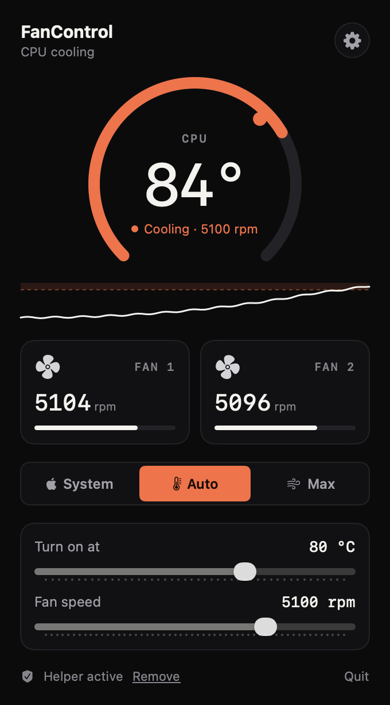

<p align="center">
  
</p>

<h1 align="center">FanControl</h1>

<p align="center">
  A macOS menu bar app that spins up the fans when the CPU gets hot. Apple Silicon.
</p>

<p align="center">
  <a href="#english"><b>🇬🇧 English</b></a>
  &nbsp;·&nbsp;
  <a href="#russian"><b>🇷🇺 Русский</b></a>
</p>

<p align="center">
  
</p>

---

<a id="english"></a>

## English

### Download

Get the latest build from the [latest release](https://github.com/ssaddist/FanControl/releases/latest): download `FanControl-<version>.dmg`, open it and drag FanControl into Applications.

The app isn't signed with an Apple developer certificate, so macOS warns you on first launch. Right-click FanControl in Applications → **Open**. On macOS 15 and later: **System Settings → Privacy & Security → Open Anyway**.

### Features

- **Live CPU temperature**: the average across all core sensors (the same way CleanMyMac calculates it), with a chart of the last 3 minutes.
- **Both fans' speed** with an animated icon that spins faster as the fan speeds up.
- **Three modes:**
  - **System** — macOS controls the fans as usual;
  - **Auto** — above the threshold the fans spin up to the set speed (5100 rpm by default); once the CPU cools down by 5 °C, control returns to macOS;
  - **Max** — the fans run at full speed all the time.
- **Turn-on threshold** (50–95 °C) and **fan speed** in Auto mode are set with two sliders.
- **Settings window** (gear in the top right corner):
  - theme — Ember, black and orange (default), or Classic purple; the app icon changes with the theme;
  - interface language — English (default) or Russian.
- **No flapping:** the temperature is smoothed over 10 seconds, and once the fans turn on they run for at least 60 seconds.
- Works in the background: the service starts with your Mac and watches the temperature even when the app is closed.

### Requirements

- An Apple Silicon Mac with fans: MacBook Pro, Mac mini, Mac Studio, iMac. MacBook Air has no fans. Tested on a MacBook Pro M3 Pro.
- Intel Macs handle fans differently, so the app doesn't work there.
- macOS 13 Ventura or later.
- Xcode or Command Line Tools (`xcode-select --install`) to build the project.

### Building from source

```bash
git clone https://github.com/ssaddist/FanControl.git
cd FanControl
./build.sh --install
```

The app is installed to `/Applications` and launched. A fan icon appears in the menu bar.

Other options:

| Command                | What it does                                                          |
| ---------------------- | --------------------------------------------------------------------- |
| `./build.sh`           | builds `build/FanControl.app` without installing it                   |
| `./build.sh --install` | builds and installs it to Applications                                |
| `./build.sh --icon`    | redraws both icons (`Tools/MakeIcon*.swift` → `Resources/*.icns`)     |
| `./build.sh --dmg`     | builds the installer image `build/FanControl-<version>.dmg`           |

macOS opens an app you built yourself without any warnings.

### First launch

Until the helper is installed, the app only shows the temperature and fan speed. macOS doesn't let regular apps change fan speed, so:

1. Click the fan icon in the menu bar.
2. Click **Enable fan control** and enter your administrator password.

This installs the `fancontrold` background service, which runs as root and applies the settings from the window. If you rebuild the app, it will offer **Helper is outdated — update** on its own.

To remove the service, click **Remove** at the bottom of the window: the fans immediately go back to macOS control.

### How it works

```
FanControl.app (user)                  fancontrold (root, launchd)
  reads sensors via SMC      ──────►     every 2 s: temperature → decision
  writes config.json                     → fan speed via SMC
  reads status.json          ◄──────     writes status.json
           /Users/Shared/FanControl/
```

| Folder / file         | Purpose                                                  |
| --------------------- | -------------------------------------------------------- |
| `App/`                | SwiftUI interface (`MenuBarExtra`), themes, translations |
| `Daemon/main.swift`   | background service, also works as a command-line tool    |
| `Shared/SMC.swift`    | talks to the SMC through IOKit: sensors and fans         |
| `Shared/Config.swift` | shared settings and status format                        |
| `Resources/`          | `Info.plist`, launchd service definition, icons          |
| `Tools/`              | draw the app icons and the installer image background    |

The service logs to `/var/log/fancontrold.log`.

#### Command-line mode

The service can also run without the window:

```bash
build/FanControl.app/Contents/Resources/fancontrold --status        # temperature and fan speed
sudo build/FanControl.app/Contents/Resources/fancontrold -t 70      # 70 °C threshold
build/FanControl.app/Contents/Resources/fancontrold --help          # all options
```

### Warning

Apple doesn't officially allow fan control. The app writes directly to the SMC system controller, and a macOS update may break it. Use it at your own risk. If something goes wrong, switch to **System** mode or remove the helper with **Remove**: the fans go back to macOS control.

### License

[MIT](LICENSE) © 2026 Александр Холин.

<p align="right"><a href="#russian">Русская версия ↓</a></p>

---

<a id="russian"></a>

## Русский

### Скачать

Готовая сборка — в [последнем релизе](https://github.com/ssaddist/FanControl/releases/latest): скачайте `FanControl-<версия>.dmg`, откройте его и перетащите FanControl в «Программы».

Приложение не подписано сертификатом разработчика Apple, поэтому при первом запуске macOS предупредит об этом. Нажмите на FanControl в «Программах» правой кнопкой → **Открыть**. В macOS 15 и новее: **Системные настройки → Конфиденциальность и безопасность → Всё равно открыть**.

### Возможности

- **Температура процессора в реальном времени**: среднее по всем датчикам ядер (так же считает CleanMyMac), график за последние 3 минуты.
- **Обороты обоих вентиляторов** с анимацией: значок крутится тем быстрее, чем быстрее вентилятор.
- **Три режима:**
  - **Система** — вентиляторами управляет macOS, как обычно;
  - **Авто** — при температуре выше порога вентиляторы раскручиваются до заданных оборотов (по умолчанию 5100 об/мин), а когда процессор остынет на 5 °C, управление возвращается macOS;
  - **Максимум** — вентиляторы постоянно работают на максимальных оборотах.
- **Порог включения** (50–95 °C) и **обороты** в режиме «Авто» задаются двумя ползунками.
- **Окно настроек** (шестерёнка в правом верхнем углу):
  - тема — чёрно-оранжевая (по умолчанию) или классическая фиолетовая, вместе с темой меняется иконка приложения;
  - язык интерфейса — английский (по умолчанию) или русский.
- **Защита от «дёрганья»:** температура сглаживается за 10 секунд, а после включения вентиляторы работают минимум 60 секунд.
- Управление работает в фоне: служба запускается вместе с Mac и следит за температурой, даже если приложение закрыто.

### Требования

- Mac на Apple Silicon с вентиляторами: MacBook Pro, Mac mini, Mac Studio, iMac. У MacBook Air вентиляторов нет. Проверено на MacBook Pro M3 Pro.
- На Intel-маках вентиляторы устроены иначе, и приложение там не работает.
- macOS 13 Ventura или новее.
- Xcode или Command Line Tools (`xcode-select --install`), чтобы собрать проект.

### Сборка из исходников

```bash
git clone https://github.com/ssaddist/FanControl.git
cd FanControl
./build.sh --install
```

Приложение установится в `/Applications` и запустится. В строке меню появится значок вентилятора.

Другие варианты:

| Команда                | Что делает                                                               |
| ---------------------- | ------------------------------------------------------------------------ |
| `./build.sh`           | собирает `build/FanControl.app`, ничего не устанавливая                  |
| `./build.sh --install` | собирает и устанавливает в «Программы»                                   |
| `./build.sh --icon`    | перерисовывает обе иконки (`Tools/MakeIcon*.swift` → `Resources/*.icns`) |
| `./build.sh --dmg`     | собирает установочный образ `build/FanControl-<версия>.dmg`              |

Собранное у себя приложение macOS открывает без предупреждений.

### Первый запуск

Пока не установлен помощник, приложение только показывает температуру и обороты. Обычной программе macOS не разрешает менять скорость вентиляторов, поэтому:

1. Нажмите на значок вентилятора в строке меню.
2. Нажмите **Включить управление** (в английском интерфейсе — **Enable fan control**) и введите пароль администратора.

После этого устанавливается фоновая служба `fancontrold`, которая работает с правами root и выполняет настройки из окна. Если вы пересоберёте приложение, оно само предложит **Помощник устарел — обновить**.

Удалить службу можно кнопкой **Удалить** внизу окна: вентиляторы сразу вернутся под управление macOS.

### Как это устроено

```
FanControl.app (пользователь)          fancontrold (root, launchd)
  читает датчики через SMC   ──────►     каждые 2 с: температура → решение
  пишет config.json                      → обороты вентиляторов через SMC
  читает status.json         ◄──────     пишет status.json
           /Users/Shared/FanControl/
```

| Папка / файл          | Назначение                                                   |
| --------------------- | ------------------------------------------------------------ |
| `App/`                | интерфейс на SwiftUI (`MenuBarExtra`), темы и переводы       |
| `Daemon/main.swift`   | фоновая служба, также работает как консольная утилита        |
| `Shared/SMC.swift`    | работа с контроллером SMC через IOKit: датчики и вентиляторы |
| `Shared/Config.swift` | общий формат настроек и статуса                              |
| `Resources/`          | `Info.plist`, описание службы для launchd, иконки            |
| `Tools/`              | рисуют иконки приложения и фон установочного образа          |

Служба пишет журнал в `/var/log/fancontrold.log`.

#### Консольный режим

Службу можно запускать и без окна:

```bash
build/FanControl.app/Contents/Resources/fancontrold --status        # температура и обороты
sudo build/FanControl.app/Contents/Resources/fancontrold -t 70      # порог 70 °C
build/FanControl.app/Contents/Resources/fancontrold --help          # все параметры
```

### Предупреждение

Apple официально не даёт управлять вентиляторами. Приложение пишет напрямую в системный контроллер SMC, и обновление macOS может это сломать. Вы используете его на свой риск. Если что-то пошло не так, выберите режим **Система** или удалите помощник кнопкой **Удалить**: вентиляторы вернутся под управление macOS.

### Лицензия

[MIT](LICENSE) © 2026 Александр Холин.

<p align="right"><a href="#english">English version ↑</a></p>
